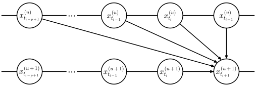
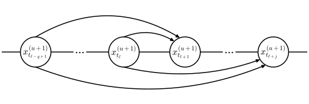

# ParaPC-FM: Accelerating Parallel Sampling via Principled Initialization

[English](README.md)

ParaPC-FM 复用已有预测，为并行采样中的未来状态提供初始化。
多张 GPU 分别计算同一张图像的不同时间步。

## 方法概览

<table>
  <tr>
    <th width="50%" align="center">迭代更新</th>
    <th width="50%" align="center">截断初始化</th>
  </tr>
  <tr>
    <td align="center" valign="top"></td>
    <td align="center" valign="top"></td>
  </tr>
  <tr>
    <td valign="top">并行计算当前窗口内各时间步的速度预测，再结合历史速度差更新状态。<code>p</code> 选择预测校正的更新规则。</td>
    <td valign="top">复用已有的速度预测，外推新进入窗口的状态。<code>q</code> 控制初始化阶数及历史信息的使用，无需额外模型评估。</td>
  </tr>
</table>

图中 <code>u</code> 表示校正迭代编号，<code>t_i</code> 表示离散采样时间点。

## 支持模型

| 模型 | 模型 ID | 示例文件 |
|---|---|---|
| FLUX.1-dev | `black-forest-labs/FLUX.1-dev` | `demos/demo_flux_paradigms.py` |
| Stable Diffusion 3 | `stabilityai/stable-diffusion-3-medium-diffusers` | `demos/demo_sd3_paradigms.py` |
| Stable Diffusion 3.5 Large | `stabilityai/stable-diffusion-3.5-large` | `demos/demo_sd35_paradigms.py` |
| Stable Diffusion 1.5 + ParaTAA | `stable-diffusion-v1-5/stable-diffusion-v1-5` | `demos/demo_sd15_parataa.py` |

## 快速开始

使用 Python 3.10 及以上版本，先安装与 CUDA 环境匹配的 PyTorch，再在仓库根目录执行：

```bash
python -m pip install -e .
```

模型管线使用 Diffusers 0.36.0。

使用 8 张 GPU 生成图像：

```bash
torchrun --standalone --nproc_per_node=8 demos/demo_flux_paradigms.py \
  --prompt "A cat holding a sign that says hello world" \
  --update_order 1 --init_order 1 --output_dir outputs/flux
```

其他模型可使用对应配置文件：

```bash
torchrun --standalone --nproc_per_node=8 demos/demo_sd3_paradigms.py --config configs/sd3.yaml
torchrun --standalone --nproc_per_node=8 demos/demo_sd35_paradigms.py --config configs/sd35.yaml
torchrun --standalone --nproc_per_node=8 demos/demo_sd15_parataa.py --config configs/sd15.yaml
```

单卡运行：

```bash
python demos/demo_flux_paradigms.py --prompt "A watercolor landscape"
```

`--nproc_per_node` 指定 GPU 数量，每张卡保存完整模型副本，包括文本编码器和 VAE。
每次调用生成一张图像。SD1.5 使用 512×512 分辨率和确定性 DDIM（`eta=0`）；
FLUX 使用蒸馏引导。

FLUX、SD3 和 SD3.5 使用 ParaDiGMS 风格的采样框架，SD1.5 使用 ParaTAA。
对应 Python 文件名分别包含 `paradigms` 或 `parataa`。

## 参数

FLUX、SD3 和 SD3.5 使用 `update_order` 选择更新规则 p，
使用 `init_order` 选择初始化阶数 q：

| 参数 | 0 | 1 | 2 |
|---|---|---|---|
| `--update_order`（p） | Euler | Heun 校正 | UniPC-2 校正 |
| `--init_order`（q） | 常值初始化 | 线性外推 | 使用历史速度差的二阶外推 |

SD1.5 使用 `--init_order`，并通过 `--taa_order`、`--memory_size`、
`--tol1` 和 `--tol2` 配置 ParaTAA。

通用参数包括 `--model_id`、`--local_files_only`、`--prompt`、`--seed`、
`--num_inference_steps`、`--height`、`--width`、`--dtype`、
`--guidance_scale`、`--window_size` 和 `--output_dir`。
`--model_id` 可指定 Hugging Face 模型 ID 或本地权重目录。
SD3、SD3.5 和 SD1.5 支持 `--negative_prompt`。
命令行参数优先于 YAML 配置；各示例的完整参数可通过 `--help` 查看。

## 输出

主进程在 `--output_dir` 中保存 `image.png` 和 `metadata.json`。
元数据包含生成参数、软件版本、GPU 数量、校正迭代次数、引导后的时间步评估次数和耗时。
每对分类器自由引导预测计为一次引导后的时间步评估。
模型加载、准备、采样和解码耗时分别记录。重复使用同一输出目录会覆盖已有示例结果。

## Python 接口

多卡使用 `torchrun` 运行以下程序，单卡使用 `python`：

```python
from parapc_fm import load_pipeline
from parapc_fm.distributed import Runtime

runtime = Runtime()
try:
    pipe = load_pipeline("flux", runtime=runtime)
    result = pipe("A watercolor landscape", update_order=1, init_order=2)
    if runtime.is_main:
        result.images[0].save("landscape.png")
finally:
    runtime.close()
```

## 实验

准备每个非空行包含一条提示词的 `prompts.txt`，运行阶数对比：

```bash
torchrun --standalone --nproc_per_node=8 scripts/benchmark.py \
  --model flux --prompts prompts.txt --count 1000 --all_update_orders \
  --num_inference_steps 50 --tolerance 0.5 --output_dir outputs/benchmark
```

脚本在相同提示词和种子下对比 q=0、1、2；
Flow 模型添加 `--all_update_orders` 后同时对比 p=0、1、2。
`--warmup` 指定每组配置的预热次数，默认为 1。
详细参数见 [实验配置](docs/reproduction.md)。

## 代码结构

```text
parapc_fm/
  prediction/     预测、初始化与数值系数
  sampling/       滑动窗口更新与收敛
  distributed/    时间步分配与通信
  models/         FLUX、SD3、SD3.5 和 SD1.5 模型管线
demos/            各模型示例
configs/          模型配置
scripts/          实验脚本
tests/            数值、模型管线与通信测试
docs/             算法说明与实验配置
```

## 测试

```bash
python -m unittest discover -s tests -v
```

测试无需下载模型权重，通信测试使用两个本机 CPU/Gloo 进程。
更新和初始化公式见 [算法说明](docs/algorithm.md)。

## 许可证

ParaPC-FM 原创部分采用 [MIT 许可证](LICENSE)。
第三方代码的许可范围见 [第三方来源说明](THIRD_PARTY_NOTICES.md)。

## 引用与致谢

论文：**ParaPC-FM: Accelerating Parallel Sampling via Principled Initialization**。

Flow 采样框架基于 [ParaDiGMS](https://github.com/AndyShih12/paradigms)。
使用该框架时，请同时引用 Shih 等人的
*Parallel Sampling of Diffusion Models*（NeurIPS 2023）。

SD1.5 采样器基于 [ParaTAA-Diffusion](https://github.com/TZW1998/ParaTAA-Diffusion)。
使用 ParaTAA 采样器时，请同时引用 Tang 等人的
*Accelerating Parallel Sampling of Diffusion Models*（ICML 2024）。
详见 [第三方来源说明](THIRD_PARTY_NOTICES.md)。
